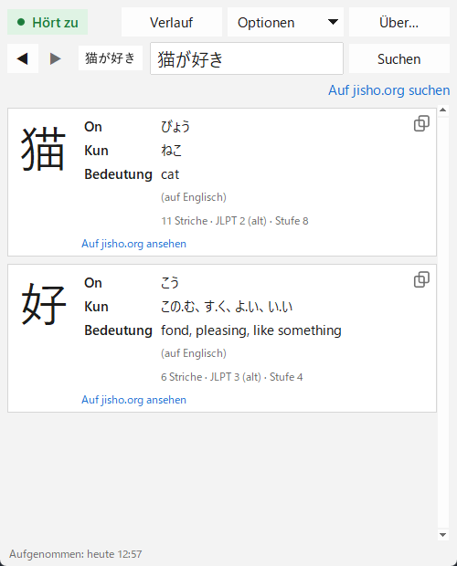

[English](README.md) · [Español](README.es.md) · [日本語](README.ja.md) · [中文](README.zh.md) · [한국어](README.ko.md) · [Português](README.pt.md) · [Français](README.fr.md) · **Deutsch**

# Yomitoru Kanji Reader 読み取る

### Leichtes und schnelles Kanji-Nachschlagen für Windows

Nimm ein beliebiges Kanji mit **Win+Shift+S** auf und sieh sofort seine Lesungen und Bedeutung. 
Eine kleine .exe · keine Installation · funktioniert offline · kostenlos und Open Source

[**⬇ yomitoru-kanji-reader.exe herunterladen**](https://github.com/kukolin/yomitoru-kanji-reader/releases/latest) ·
[Bedienung](#bedienung) ·
[FAQ](#faq)

---

## Leicht und schnell

*Yomitoru* (読み取る) heißt auf Japanisch „ablesen, erfassen“. Yomitoru Kanji Reader soll dich nicht stören, während du Japanisch liest: einen Manga, eine Website, ein Spiel oder Untertitel. Taucht ein unbekanntes Kanji auf, musst du es nicht in einer Strichsuche nachzeichnen. Du nimmst es auf, und die Antwort ist sofort da.

| | |
| --- | --- |
| **Schnell** | Etwa **0,1 s** vom Screenshot bis zum Ergebnis. Die Texterkennung selbst dauert ~30 ms. |
| **Leicht** | Eine einzige **20 MB** große .exe. Kein Installer, keine zusätzliche Laufzeit; ~60–80 MB RAM im Betrieb. |
| **Offline** | Nutzt die in Windows eingebaute Texterkennung und ein mitgeliefertes Wörterbuch. Nichts wird gesendet; nur die jisho.org-Links brauchen Internet. |
| **Unauffällig** | Wartet im Infobereich der Taskleiste. Es prüft nur zweimal pro Sekunde einen Zähler der Zwischenablage und braucht daher kaum CPU. |

## Was angezeigt wird

Für jedes Kanji im Screenshot:

| | |
| --- | --- |
| **Das Kanji** | groß, damit die Striche gut zu sehen sind |
| **On'yomi** | die sinojapanische Lesung, in Hiragana (にち、じつ) |
| **Kun'yomi** | die japanische Lesung, in Hiragana (ひ、-び、-か) |
| **Bedeutung** | in der Sprache der App, wenn das Wörterbuch sie hat (Englisch, Spanisch, Französisch oder Portugiesisch), sonst auf Englisch |
| **Extras** | Strichzahl, JLPT-Stufe und japanische Schulstufe |
| **jisho.org** | ein Link zum vollständigen Eintrag des Kanji |

**Auf jisho.org suchen** sucht nach dem, was gerade im Textfeld steht: das ganze Wort oder den ganzen Satz. Liegt die Erkennung daneben, **korrigiere den Text** und suche erneut.

Jede Suche landet im **Verlauf**, mit ◀ ▶ kommst du zu einem Kanji von vorhin zurück. Es gibt einen **Dunkelmodus**, und die App gibt es in **10 Sprachen**: Deutsch, English, español, 日本語, 中文, 한국어, français, português, italiano und русский. Da KANJIDIC2 keine deutschen Bedeutungen enthält, werden sie auf Englisch angezeigt.

## Installation

### 1. Herunterladen

Lade unter [**Releases**](https://github.com/kukolin/yomitoru-kanji-reader/releases/latest) die Datei **`yomitoru-kanji-reader.exe`** herunter. Keine Installation nötig: Leg sie in einen beliebigen Ordner und starte sie per Doppelklick.

> **„Der Computer wurde durch Windows geschützt“**: Die .exe ist nicht digital signiert, daher kann SmartScreen beim ersten Start diese Warnung zeigen. Klicke auf **Weitere Informationen → Trotzdem ausführen**.

### 2. Japanische Texterkennung von Windows aktivieren (einmalig)

1. Öffne **Einstellungen → Zeit und Sprache → Sprache und Region**.
2. Klicke unter „Bevorzugte Sprachen“ auf **Sprache hinzufügen**.
3. Suche **Japanisch** (日本語) und wähle es aus.
4. Lass **Optische Zeichenerkennung (OCR)** aktiviert (der Rest ist optional) und installiere.
5. Öffne Yomitoru Kanji Reader erneut.

Die Anzeigesprache von Windows und die Tastatur musst du nicht ändern. Fehlt die japanische Texterkennung, weist dich die App beim Start darauf hin.

### 3. (Optional) Mit Windows starten

Drücke **Win+R**, gib `shell:startup` ein und drücke Enter. Erstelle im geöffneten Ordner eine Verknüpfung zu `yomitoru-kanji-reader.exe`.

## Bedienung

1. Öffne Yomitoru Kanji Reader. **● Hört zu** oben links bedeutet, dass es auf deine Screenshots wartet. Im Infobereich erscheint außerdem ein rotes **読**-Symbol.
2. Siehst du ein unbekanntes Kanji, drücke **Win+Shift+S** und ziehe ein Rechteck darum.
3. Das Fenster erscheint mit dem Ergebnis.
4. **Esc** blendet es aus. Beim nächsten Screenshot kommt es wieder.

**Tipps:** Rahme nur den Text mit etwas Rand ein (ein Wort oder eine Zeile funktioniert besser als ein Absatz). Senkrechter Text (縦書き) wird noch nicht unterstützt: Nimm ein Zeichen nach dem anderen auf.

| Bedienelement | |
| --- | --- |
| **● Hört zu / ○ Aus** | ein Klick pausiert oder setzt die Screenshot-Erkennung fort (auch über das Infobereich-Symbol) |
| **◀ ▶** (oder **Alt+←** / **Alt+→**) | vorherige oder nächste Suche im Verlauf |
| **Verlauf** (oder **Strg+H**) | alle Suchen mit Datum; Doppelklick öffnet eine erneut, und ein Knopf löscht den Verlauf |
| **Auf jisho.org suchen** | sucht auf jisho.org nach dem Inhalt des Textfelds |
| **Kopieren** | eine Lesung oder Bedeutung markieren und **Strg+C** drücken (oder Rechtsklick → **Kopieren**); das Symbol unter jedem Kanji kopiert das Kanji direkt |
| **Optionen** | Fenster bei jedem Screenshot anzeigen, immer im Vordergrund, Dunkelmodus und Sprache |
| **Esc** oder das **X** des Fensters | blendet das Fenster aus; die App läuft im Infobereich weiter |
| Rechtsklick auf **読** → **Beenden** | schließt Yomitoru Kanji Reader vollständig |

## FAQ

**Speichert oder sendet es meine Screenshots?**
Nein. Bilder werden nur im Arbeitsspeicher deines PCs verarbeitet und weder gespeichert noch gesendet. Der Verlauf enthält nur den erkannten Text und das Datum und lässt sich jederzeit über **Verlauf → Verlauf löschen…** leeren.

**一, 二 oder 三 werden nicht erkannt.**
Das ist eine Grenze der Windows-Texterkennung: Kanji, die nur aus waagerechten Strichen bestehen, werden nicht als Text erkannt. Gib sie im Textfeld ein.

**Was bedeutet „JLPT (alt)“?**
Die JLPT-Skala vor 2010, von 4 (Anfänger) bis 1 (fortgeschritten). Grob: 4 ≈ N5, 3 ≈ N4, 2 ≈ N3/N2, 1 ≈ N1.

## Für Entwickler

Start aus dem Quellcode, Funktionsweise und Erstellen der .exe: siehe das [englische README](README.md#from-source).

## Autor

Erstellt von **Lucas Anezin** ([@kukolin](https://github.com/kukolin)). Einen Fehler gefunden oder eine Idee? Eröffne ein [Issue](https://github.com/kukolin/yomitoru-kanji-reader/issues).

## Lizenzen

Code: [MIT](LICENSE) © 2026 Lucas Anezin. Dieses Programm verwendet die Datei [KANJIDIC2](https://www.edrdg.org/wiki/index.php/KANJIDIC_Project), Eigentum der **Electronic Dictionary Research and Development Group (EDRDG)**, gemäß ihrer [Lizenz](https://www.edrdg.org/edrdg/licence.html) **CC BY-SA 4.0**. OCR: `Windows.Media.Ocr` von Microsoft.
