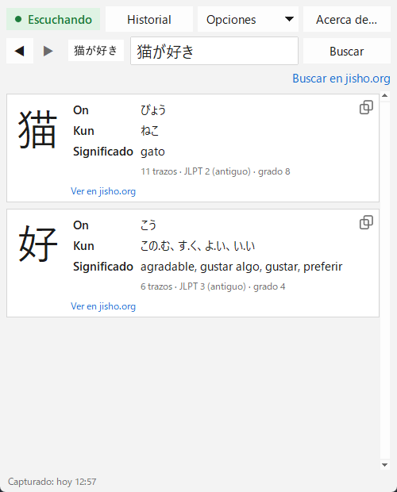

[English](README.md) · **Español** · [日本語](README.ja.md) · [中文](README.zh.md) · [한국어](README.ko.md) · [Português](README.pt.md) · [Français](README.fr.md) · [Deutsch](README.de.md)

# Yomitoru Kanji Reader 読み取る

### Consulta de kanji liviana y rápida para Windows

Capturá cualquier kanji con **Win+Shift+S** y mirá al instante cómo se lee y qué significa. 
Un solo .exe chico · sin instalador · funciona sin internet · gratis y de código abierto

[**⬇ Descargar yomitoru-kanji-reader.exe**](https://github.com/kukolin/yomitoru-kanji-reader/releases/latest) ·
[Cómo se usa](#cómo-se-usa) ·
[Preguntas frecuentes](#preguntas-frecuentes)

---

## Liviano y rápido

*Yomitoru* (読み取る) significa «leer, captar» en japonés. Yomitoru Kanji Reader está hecho para no molestarte mientras leés japonés: un manga, una página web, un juego o subtítulos. Cuando aparece un kanji que no conocés, no hace falta dibujarlo en un buscador por trazos: lo capturás y la respuesta ya está ahí.

| | |
| --- | --- |
| **Rápido** | Unos **0,1 s** desde la captura hasta el resultado. El reconocimiento en sí tarda ~30 ms. |
| **Liviano** | Un solo .exe de **20 MB**. Sin instalador ni nada extra que instalar; usa ~60–80 MB de RAM. |
| **Sin internet** | Usa el OCR que ya trae Windows y un diccionario incluido. No envía nada a ningún lado; solo los links a jisho.org necesitan conexión. |
| **Silencioso** | Espera en la bandeja del sistema. Solo revisa un contador del portapapeles dos veces por segundo, así que casi no usa CPU. |

## Qué muestra

Por cada kanji de la captura:

| | |
| --- | --- |
| **El kanji** | en grande, para ver bien los trazos |
| **On'yomi** | la lectura de origen chino, en hiragana (にち、じつ) |
| **Kun'yomi** | la lectura japonesa, en hiragana (ひ、-び、-か) |
| **Significado** | en el idioma de la app cuando el diccionario lo tiene (español, inglés, francés o portugués), si no en inglés |
| **Datos extra** | cantidad de trazos, nivel JLPT y grado escolar japonés |
| **jisho.org** | un link a la ficha completa del kanji |

**Buscar en jisho.org** busca lo que esté escrito en el campo de texto: la palabra o la frase completa. Si el reconocimiento se equivoca, **corregí el texto** y volvé a buscar.

Cada búsqueda queda en el **historial**, así que con ◀ ▶ volvés a un kanji de hace un rato. Tiene **modo oscuro** y está en **10 idiomas**: español, English, 日本語, 中文, 한국어, français, português, Deutsch, italiano y русский.

## Instalación

### 1. Descargá el programa

Entrá a [**Releases**](https://github.com/kukolin/yomitoru-kanji-reader/releases/latest) y bajá **`yomitoru-kanji-reader.exe`**. No se instala: guardalo en la carpeta que quieras y abrilo con doble clic.

> **«Windows protegió tu PC»**: como el ejecutable no está firmado digitalmente, Windows SmartScreen puede mostrar este aviso la primera vez. Hacé clic en **Más información → Ejecutar de todas formas**.

### 2. Activá el OCR japonés de Windows (una sola vez)

1. Abrí **Configuración → Hora e idioma → Idioma y región**.
2. En «Idiomas preferidos», hacé clic en **Agregar un idioma**.
3. Buscá **Japonés** (日本語) y seleccionalo.
4. Dejá marcada la opción **Reconocimiento óptico de caracteres (OCR)** (las demás son opcionales) e instalá.
5. Reabrí Yomitoru Kanji Reader.

No hace falta cambiar el idioma de Windows ni el teclado. Si falta el OCR japonés, la app te avisa al abrirse.

### 3. (Opcional) Que se abra al iniciar Windows

Presioná **Win+R**, escribí `shell:startup` y Enter. En la carpeta que se abre, creá un acceso directo a `yomitoru-kanji-reader.exe`.

## Cómo se usa

1. Abrí Yomitoru Kanji Reader. **● Escuchando**, arriba a la izquierda, indica que está atento a tus capturas. También aparece un ícono rojo **読** en la bandeja del sistema.
2. Cuando veas un kanji que no conocés, presioná **Win+Shift+S** y encerralo en un rectángulo.
3. La ventana aparece con el resultado.
4. **Esc** la esconde. Vuelve a aparecer con la próxima captura.

**Consejos:** encuadrá solo el texto, con un poco de margen (una palabra o una línea funciona mejor que un párrafo). El texto vertical (縦書き) todavía no está soportado: capturá un carácter por vez.

| Control | |
| --- | --- |
| **● Escuchando / ○ Apagado** | un clic pausa o reanuda la detección de capturas (también desde la bandeja) |
| **◀ ▶** (o **Alt+←** / **Alt+→**) | búsqueda anterior o siguiente del historial |
| **Historial** (o **Ctrl+H**) | todas las búsquedas con su fecha; doble clic para volver a abrir una, y un botón para borrarlo |
| **Buscar en jisho.org** | busca en jisho.org lo que esté escrito en el campo de texto |
| **Copiar** | seleccioná cualquier lectura o significado y presioná **Ctrl+C** (o clic derecho → **Copiar**); el ícono debajo de cada kanji copia el kanji directamente |
| **Opciones** | mostrar la ventana al capturar, siempre visible, modo oscuro e idioma |
| **Esc** o la **X** | esconde la ventana; la app sigue en la bandeja |
| Clic derecho en **読** → **Salir** | cierra Yomitoru Kanji Reader del todo |

Las opciones y el historial (solo el texto, nunca las imágenes) se guardan en `%APPDATA%\Yomitoru`.

## Preguntas frecuentes

**¿Guarda mis capturas o las manda a algún lado?**
No. Las imágenes se procesan en memoria, en tu PC, y nunca se guardan ni se envían. El historial guarda solo el texto y la fecha, y lo podés borrar desde **Historial → Borrar historial…**.

**No reconoce 一, 二 o 三.**
Es una limitación del OCR de Windows: los kanji hechos solo de rayas horizontales no los detecta como texto. Escribilos a mano.

**Saqué una captura y no pasó nada.**
Fijate que diga **● Escuchando** y no **○ Apagado**. Si Win+Shift+S no abre el recorte, la herramienta Recortes de Windows puede haberse colgado: en el Administrador de tareas (Ctrl+Shift+Esc) finalizá los procesos «Recortes» y probá de nuevo.

**¿Por qué el significado aparece en inglés?**
KANJIDIC2 tiene significados en inglés para ~10.400 kanji, y en español para ~2.500 (los más comunes). Si no hay traducción, se muestra en inglés con una aclaración.

**¿Qué es «JLPT (antiguo)»?**
La escala del JLPT anterior a 2010, de 4 (básico) a 1 (avanzado). Aproximadamente: 4 ≈ N5, 3 ≈ N4, 2 ≈ N3/N2, 1 ≈ N1.

## Para desarrolladores

Cómo correrlo desde el código, cómo funciona por dentro y cómo compilar el .exe: ver el [README en inglés](README.md#from-source).

## Autor

Creado por **Lucas Anezin** ([@kukolin](https://github.com/kukolin)). ¿Encontraste un error o tenés una idea? Abrí un [issue](https://github.com/kukolin/yomitoru-kanji-reader/issues).

## Licencias

Código: [MIT](LICENSE) © 2026 Lucas Anezin. Este programa usa el archivo [KANJIDIC2](https://www.edrdg.org/wiki/index.php/KANJIDIC_Project), propiedad del **Electronic Dictionary Research and Development Group (EDRDG)**, de acuerdo con su [licencia](https://www.edrdg.org/edrdg/licence.html) **CC BY-SA 4.0**. OCR: `Windows.Media.Ocr` de Microsoft.
