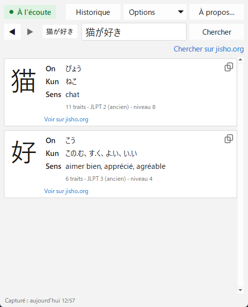

[English](README.md) · [Español](README.es.md) · [日本語](README.ja.md) · [中文](README.zh.md) · [한국어](README.ko.md) · [Português](README.pt.md) · **Français** · [Deutsch](README.de.md)

# Yomitoru Kanji Reader 読み取る

### Recherche de kanji légère et rapide pour Windows

Capturez n'importe quel kanji avec **Win+Shift+S** et voyez aussitôt ses lectures et son sens. 
Un seul petit .exe · sans installation · fonctionne hors ligne · gratuit et open source

[**⬇ Télécharger yomitoru-kanji-reader.exe**](https://github.com/kukolin/yomitoru-kanji-reader/releases/latest) ·
[Utilisation](#utilisation) ·
[FAQ](#faq)

---

## Léger et rapide

*Yomitoru* (読み取る) signifie « lire, saisir » en japonais. Yomitoru Kanji Reader est conçu pour ne pas vous gêner pendant que vous lisez du japonais : un manga, un site web, un jeu ou des sous-titres. Quand un kanji inconnu apparaît, inutile de le dessiner dans une recherche par traits : capturez-le et la réponse est déjà là.

| | |
| --- | --- |
| **Rapide** | Environ **0,1 s** entre la capture et le résultat. La reconnaissance elle-même prend ~30 ms. |
| **Léger** | Un seul .exe de **20 Mo**. Pas d'installateur ni de runtime à installer ; ~60–80 Mo de RAM en fonctionnement. |
| **Hors ligne** | Utilise l'OCR intégré à Windows et un dictionnaire inclus. Rien n'est envoyé ; seuls les liens jisho.org nécessitent Internet. |
| **Discret** | Attend dans la zone de notification. Il ne vérifie qu'un compteur du presse-papiers deux fois par seconde, donc il n'utilise presque pas de CPU. |

## Ce qu'il affiche

Pour chaque kanji de la capture :

| | |
| --- | --- |
| **Le kanji** | en grand, pour bien voir les traits |
| **On'yomi** | la lecture d'origine chinoise, en hiragana (にち、じつ) |
| **Kun'yomi** | la lecture japonaise, en hiragana (ひ、-び、-か) |
| **Sens** | dans la langue de l'application quand le dictionnaire l'a (français, anglais, espagnol ou portugais), sinon en anglais |
| **Infos** | nombre de traits, niveau JLPT et année scolaire japonaise |
| **jisho.org** | un lien vers la fiche complète du kanji |

**Chercher sur jisho.org** recherche ce qui est saisi dans le champ de texte : le mot ou la phrase entière. Si la reconnaissance se trompe, **corrigez le texte** et relancez la recherche.

Chaque recherche est gardée dans l'**historique** : ◀ ▶ vous ramènent à un kanji vu un peu plus tôt. Il y a un **mode sombre**, et l'application existe en **10 langues** : français, English, español, 日本語, 中文, 한국어, português, Deutsch, italiano et русский.

## Installation

### 1. Téléchargez

Allez dans [**Releases**](https://github.com/kukolin/yomitoru-kanji-reader/releases/latest) et téléchargez **`yomitoru-kanji-reader.exe`**. Rien à installer : placez-le dans le dossier de votre choix et double-cliquez dessus.

> **« Windows a protégé votre ordinateur »** : le .exe n'est pas signé numériquement, donc SmartScreen peut afficher cet avertissement la première fois. Cliquez sur **Informations complémentaires → Exécuter quand même**.

### 2. Activez l'OCR japonais de Windows (une seule fois)

1. Ouvrez **Paramètres → Heure et langue → Langue et région**.
2. Sous « Langues préférées », cliquez sur **Ajouter une langue**.
3. Recherchez **Japonais** (日本語) et sélectionnez-le.
4. Laissez cochée **Reconnaissance optique de caractères (OCR)** (le reste est facultatif) et installez.
5. Rouvrez Yomitoru Kanji Reader.

Inutile de changer la langue d'affichage de Windows ou le clavier. S'il manque l'OCR japonais, l'application vous prévient au démarrage.

### 3. (Facultatif) Démarrer avec Windows

Appuyez sur **Win+R**, tapez `shell:startup` puis Entrée. Dans le dossier qui s'ouvre, créez un raccourci vers `yomitoru-kanji-reader.exe`.

## Utilisation

1. Ouvrez Yomitoru Kanji Reader. **● À l'écoute**, en haut à gauche, indique qu'il attend vos captures. Une icône rouge **読** apparaît aussi dans la zone de notification.
2. Quand vous voyez un kanji inconnu, appuyez sur **Win+Shift+S** et entourez-le d'un rectangle.
3. La fenêtre apparaît avec le résultat.
4. **Échap** la masque. Elle revient à la capture suivante.

**Conseils :** n'encadrez que le texte, avec une petite marge (un mot ou une ligne marche mieux qu'un paragraphe). Le texte vertical (縦書き) n'est pas encore pris en charge : capturez un caractère à la fois.

| Commande | |
| --- | --- |
| **● À l'écoute / ○ Désactivé** | un clic suspend ou reprend la détection des captures (aussi depuis l'icône de notification) |
| **◀ ▶** (ou **Alt+←** / **Alt+→**) | recherche précédente ou suivante de l'historique |
| **Historique** (ou **Ctrl+H**) | toutes les recherches avec leur date ; double-clic pour en rouvrir une, et un bouton pour l'effacer |
| **Chercher sur jisho.org** | recherche sur jisho.org le contenu du champ de texte |
| **Copier** | sélectionnez une lecture ou un sens et appuyez sur **Ctrl+C** (ou clic droit → **Copier**) ; l'icône sous chaque kanji copie directement le kanji |
| **Options** | afficher la fenêtre à chaque capture, toujours au premier plan, mode sombre et langue |
| **Échap** ou le **X** de la fenêtre | masque la fenêtre ; l'application reste dans la zone de notification |
| Clic droit sur **読** → **Quitter** | ferme complètement Yomitoru Kanji Reader |

## FAQ

**Est-ce qu'il enregistre ou envoie mes captures ?**
Non. Les images sont traitées en mémoire sur votre PC et ne sont jamais enregistrées ni envoyées. L'historique ne garde que le texte reconnu et la date, et peut être effacé avec **Historique → Effacer l'historique…**.

**Il ne reconnaît pas 一, 二 ou 三.**
C'est une limite de l'OCR de Windows : les kanji faits uniquement de traits horizontaux ne sont pas détectés comme du texte. Saisissez-les dans le champ de texte.

**Pourquoi le sens est-il en anglais ?**
KANJIDIC2 contient des sens en anglais pour ~10 400 kanji et en français pour ~2 100 (les plus courants). Sans traduction, le sens anglais s'affiche avec une mention.

**Que signifie « JLPT (ancien) » ?**
L'échelle du JLPT d'avant 2010, de 4 (débutant) à 1 (avancé). En gros : 4 ≈ N5, 3 ≈ N4, 2 ≈ N3/N2, 1 ≈ N1.

## Pour les développeurs

Lancer depuis le code source, fonctionnement interne et compilation du .exe : voir le [README en anglais](README.md#from-source).

## Auteur

Créé par **Lucas Anezin** ([@kukolin](https://github.com/kukolin)). Un bug ou une idée ? Ouvrez une [issue](https://github.com/kukolin/yomitoru-kanji-reader/issues).

## Licences

Code : [MIT](LICENSE) © 2026 Lucas Anezin. Ce programme utilise le fichier [KANJIDIC2](https://www.edrdg.org/wiki/index.php/KANJIDIC_Project), propriété de l'**Electronic Dictionary Research and Development Group (EDRDG)**, conformément à sa [licence](https://www.edrdg.org/edrdg/licence.html) **CC BY-SA 4.0**. OCR : `Windows.Media.Ocr` de Microsoft.
