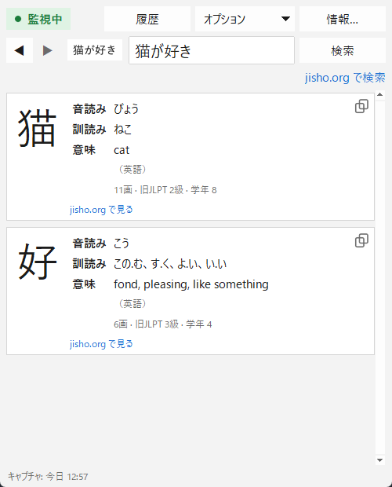

[English](README.md) · [Español](README.es.md) · **日本語** · [中文](README.zh.md) · [한국어](README.ko.md) · [Português](README.pt.md) · [Français](README.fr.md) · [Deutsch](README.de.md)

# Yomitoru Kanji Reader 読み取る

### Windows 向けの軽くて速い漢字検索ツール

**Win+Shift+S** で漢字をキャプチャすると、読み方と意味がすぐに表示されます。 
小さな .exe ひとつ · インストール不要 · オフラインで動作 · 無料・オープンソース

[**⬇ yomitoru-kanji-reader.exe をダウンロード**](https://github.com/kukolin/yomitoru-kanji-reader/releases/latest) ·
[使い方](#使い方) ·
[よくある質問](#よくある質問)

---

## 軽くて速い

Yomitoru Kanji Reader は、マンガ、ウェブサイト、ゲーム、字幕など、日本語を読んでいるときに邪魔にならないように作られています。知らない漢字が出てきたら、手書き検索で描く必要はありません。キャプチャするだけで、すぐに答えが表示されます。

| | |
| --- | --- |
| **速い** | キャプチャから結果表示まで約 **0.1 秒**。文字認識そのものは約 30 ミリ秒です。 |
| **軽い** | **20 MB** の .exe ひとつだけ。インストーラーも追加のランタイムも不要で、メモリ使用量は約 60〜80 MB です。 |
| **オフライン** | Windows 標準の OCR と同梱の辞書を使います。データはどこにも送信されません（jisho.org へのリンクを開くときだけインターネットが必要です）。 |
| **静か** | 通知領域で待機し、1 秒に 2 回クリップボードのカウンターを確認するだけなので、CPU はほとんど使いません。 |

## 表示される内容

キャプチャした漢字ごとに:

| | |
| --- | --- |
| **漢字** | 画数がよく見えるように大きく表示 |
| **音読み** | ひらがなで表示（にち、じつ） |
| **訓読み** | ひらがなで表示（ひ、-び、-か） |
| **意味** | 辞書にある場合はアプリの言語（英語・スペイン語・フランス語・ポルトガル語）、ない場合は英語 |
| **その他** | 画数、JLPT レベル、学年 |
| **jisho.org** | 漢字の詳しいページへのリンク |

**jisho.org で検索** を押すと、テキスト欄に入力されている単語や文をそのまま検索します。認識を間違えた場合は、**テキストを直して** もう一度検索できます。

検索はすべて **履歴** に残るので、◀ ▶ で少し前の漢字に戻れます。**ダークモード** にも対応し、**10 言語**（English、español、日本語、中文、한국어、français、português、Deutsch、italiano、русский）で使えます。

## インストール

### 1. ダウンロード

[**Releases**](https://github.com/kukolin/yomitoru-kanji-reader/releases/latest) から **`yomitoru-kanji-reader.exe`** をダウンロードします。インストールは不要です。好きなフォルダーに置いてダブルクリックしてください。

> **「Windows によって PC が保護されました」**: この .exe にはデジタル署名がないため、初回に SmartScreen の警告が出ることがあります。**[詳細情報] → [実行]** をクリックしてください。

### 2. Windows の日本語 OCR を有効にする（初回のみ）

日本語版 Windows では通常すでに入っています。入っていない場合はアプリが起動時に知らせます。

1. **[設定] → [時刻と言語] → [言語と地域]** を開きます。
2. **[言語の追加]** をクリックします。
3. **日本語** を選択します。
4. **[光学式文字認識 (OCR)]** にチェックを入れてインストールします。
5. Yomitoru Kanji Reader を再起動します。

### 3. （任意）Windows の起動時に開く

**Win+R** を押して `shell:startup` と入力し、開いたフォルダーに `yomitoru-kanji-reader.exe` のショートカットを作成します。

## 使い方

1. Yomitoru Kanji Reader を開きます。左上の **● 監視中** は、キャプチャを待っている状態です。通知領域には赤い **読** アイコンも表示されます。
2. 知らない漢字を見つけたら、**Win+Shift+S** を押して四角で囲みます。
3. ウィンドウが前面に表示され、結果が出ます。
4. **Esc** でウィンドウを隠せます。次のキャプチャで再び表示されます。

**コツ:** 文字だけを少し余白をつけて囲んでください（段落より単語や 1 行のほうが正確です）。縦書きにはまだ対応していないので、1 文字ずつキャプチャしてください。

| 操作 | |
| --- | --- |
| **● 監視中 / ○ 停止中** | クリックでキャプチャの検出を停止・再開（通知領域のアイコンからも可能） |
| **◀ ▶**（または **Alt+←** / **Alt+→**） | 履歴の前・次の検索 |
| **履歴**（または **Ctrl+H**） | すべての検索と日時。ダブルクリックで開き直せます。削除ボタンもあります |
| **jisho.org で検索** | テキスト欄の内容を jisho.org で検索 |
| **コピー** | 読みや意味を選択して **Ctrl+C**（または右クリック → **コピー**）。各漢字の下のアイコンで漢字をそのままコピーできます |
| **オプション** | キャプチャ時にウィンドウを表示、キャプチャ時に jisho.org を直接開く（日本語のテキストがあれば、ウィンドウを出さずに jisho.org で検索）、常に手前に表示、ダークモード、言語（初期設定は英語。**オプション → 言語 / Language** で変更できます） |
| **Esc** またはウィンドウの **×** | ウィンドウを隠します（アプリは通知領域で動き続けます） |
| **読** を右クリック → **終了** | Yomitoru Kanji Reader を完全に終了 |

## よくある質問

**キャプチャを保存したり送信したりしますか？**
いいえ。画像はパソコンのメモリ上で処理され、保存も送信もされません。履歴に残るのは認識したテキストと日時だけで、**履歴 → 履歴を削除…** からいつでも消せます。

**一・二・三 を認識しません。**
Windows OCR の制限で、横線だけの漢字は文字として検出されません。テキスト欄に入力してください。

**意味が英語で表示されるのはなぜ？**
KANJIDIC2 には日本語の意味の項目がないため、日本語で使う場合は英語の意味を表示します。

**「旧JLPT」とは？**
2010 年以前の JLPT の級（4 級〜1 級）です。おおよそ 4 級 ≈ N5、3 級 ≈ N4、2 級 ≈ N3/N2、1 級 ≈ N1 です。

## 開発者向け

ソースからの実行方法、仕組み、.exe のビルド方法は [英語の README](README.md#from-source) をご覧ください。

## 作者

**Lucas Anezin**（[@kukolin](https://github.com/kukolin)）。不具合の報告や提案は [Issues](https://github.com/kukolin/yomitoru-kanji-reader/issues) へどうぞ。

## ライセンス

コード: [MIT](LICENSE) © 2026 Lucas Anezin。このプログラムは、**Electronic Dictionary Research and Development Group (EDRDG)** が所有する [KANJIDIC2](https://www.edrdg.org/wiki/index.php/KANJIDIC_Project) ファイルを、同グループの [ライセンス](https://www.edrdg.org/edrdg/licence.html)（**CC BY-SA 4.0**）に従って使用しています。OCR: Microsoft の `Windows.Media.Ocr`。
