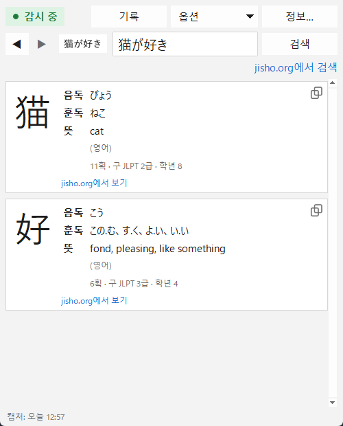

[English](README.md) · [Español](README.es.md) · [日本語](README.ja.md) · [中文](README.zh.md) · **한국어** · [Português](README.pt.md) · [Français](README.fr.md) · [Deutsch](README.de.md)

# Yomitoru Kanji Reader 読み取る

### 가볍고 빠른 Windows용 일본어 한자 검색 도구

**Win+Shift+S**로 한자를 캡처하면 읽는 법과 뜻을 바로 볼 수 있습니다. 
작은 .exe 하나 · 설치 불필요 · 오프라인 동작 · 무료 오픈 소스

[**⬇ yomitoru-kanji-reader.exe 다운로드**](https://github.com/kukolin/yomitoru-kanji-reader/releases/latest) ·
[사용 방법](#사용-방법) ·
[자주 묻는 질문](#자주-묻는-질문)

---

## 가볍고 빠르게

*Yomitoru*(読み取る)는 일본어로 '읽어 내다'라는 뜻입니다. Yomitoru Kanji Reader는 만화, 웹사이트, 게임, 자막 등 일본어를 읽는 동안 방해가 되지 않도록 만들어졌습니다. 모르는 한자가 나오면 필기 입력으로 그릴 필요 없이 캡처만 하면 바로 답이 나옵니다.

| | |
| --- | --- |
| **빠름** | 캡처부터 결과까지 약 **0.1초**. 문자 인식 자체는 약 30ms입니다. |
| **가벼움** | **20MB** .exe 하나뿐입니다. 설치 프로그램이나 추가 런타임이 필요 없고, 실행 중 메모리는 약 60~80MB입니다. |
| **오프라인** | Windows 기본 OCR과 내장 사전을 사용합니다. 어떤 데이터도 전송하지 않습니다(jisho.org 링크를 열 때만 인터넷이 필요). |
| **조용함** | 알림 영역에서 대기하며 1초에 두 번 클립보드 카운터만 확인하므로 CPU를 거의 쓰지 않습니다. |

## 보여 주는 내용

캡처한 한자마다:

| | |
| --- | --- |
| **한자** | 획이 잘 보이도록 크게 표시 |
| **음독** | 히라가나로 표시(にち、じつ) |
| **훈독** | 히라가나로 표시(ひ、-び、-か) |
| **뜻** | 사전에 있으면 앱 언어(영어, 스페인어, 프랑스어, 포르투갈어)로, 없으면 영어로 표시 |
| **추가 정보** | 획수, JLPT 급수, 일본 학년 |
| **jisho.org** | 한자의 자세한 페이지 링크 |

**jisho.org에서 검색**은 텍스트 칸에 입력된 단어나 문장을 그대로 검색합니다. 인식이 틀렸다면 **텍스트를 고친 뒤** 다시 검색하세요.

모든 검색은 **기록**에 남아서 ◀ ▶로 조금 전에 찾은 한자로 돌아갈 수 있습니다. **다크 모드**를 지원하며, **10개 언어**(English, español, 日本語, 中文, 한국어, français, português, Deutsch, italiano, русский)로 사용할 수 있습니다.

## 설치

### 1. 다운로드

[**Releases**](https://github.com/kukolin/yomitoru-kanji-reader/releases/latest)에서 **`yomitoru-kanji-reader.exe`**를 받으세요. 설치할 필요 없이 원하는 폴더에 두고 더블클릭하면 됩니다.

> **"Windows의 PC 보호"**: 이 .exe에는 디지털 서명이 없어서 처음 실행할 때 SmartScreen 경고가 나올 수 있습니다. **추가 정보 → 실행**을 클릭하세요.

### 2. Windows 일본어 OCR 켜기(한 번만)

1. **설정 → 시간 및 언어 → 언어 및 지역**을 엽니다.
2. '기본 설정 언어'에서 **언어 추가**를 클릭합니다.
3. **일본어**(日本語)를 검색해 선택합니다.
4. **광학 문자 인식(OCR)**을 선택한 채로 설치합니다(다른 기능은 선택 사항).
5. Yomitoru Kanji Reader를 다시 엽니다.

Windows 표시 언어나 키보드를 바꿀 필요는 없습니다. 일본어 OCR이 없으면 앱이 시작할 때 알려 줍니다.

### 3. (선택) Windows 시작 시 실행

**Win+R**을 누르고 `shell:startup`을 입력한 뒤, 열린 폴더에 `yomitoru-kanji-reader.exe` 바로 가기를 만드세요.

## 사용 방법

1. Yomitoru Kanji Reader를 엽니다. 왼쪽 위의 **● 감시 중**은 캡처를 기다리는 상태라는 뜻입니다. 알림 영역에 빨간 **読** 아이콘도 나타납니다.
2. 모르는 한자가 보이면 **Win+Shift+S**를 눌러 사각형으로 감쌉니다.
3. 창이 앞으로 나와 결과를 보여 줍니다.
4. **Esc**로 창을 숨길 수 있으며, 다음 캡처 때 다시 나타납니다.

**팁:** 글자만 약간의 여백과 함께 감싸세요(문단보다 단어나 한 줄이 더 정확합니다). 세로쓰기(縦書き)는 아직 지원하지 않으니 한 글자씩 캡처하세요.

| 조작 | |
| --- | --- |
| **● 감시 중 / ○ 꺼짐** | 클릭하면 캡처 감지를 일시 정지하거나 다시 시작(알림 영역 아이콘에서도 가능) |
| **◀ ▶**(또는 **Alt+←** / **Alt+→**) | 기록의 이전·다음 검색 |
| **기록**(또는 **Ctrl+H**) | 모든 검색과 날짜. 더블클릭으로 다시 열 수 있고, 삭제 버튼도 있습니다 |
| **jisho.org에서 검색** | 텍스트 칸의 내용을 jisho.org에서 검색 |
| **복사** | 읽는 법이나 뜻을 선택하고 **Ctrl+C**(또는 오른쪽 클릭 → **복사**). 각 한자 아래의 아이콘을 누르면 한자를 바로 복사합니다 |
| **옵션** | 캡처할 때 창 표시, 항상 위에 표시, 다크 모드, 언어 |
| **Esc** 또는 창의 **X** | 창을 숨깁니다(앱은 알림 영역에서 계속 실행) |
| **読** 오른쪽 클릭 → **종료** | Yomitoru Kanji Reader를 완전히 종료 |

## 자주 묻는 질문

**캡처를 저장하거나 어딘가로 보내나요?**
아니요. 이미지는 PC 메모리에서만 처리되며 저장하거나 전송하지 않습니다. 기록에는 인식된 텍스트와 날짜만 남고, **기록 → 기록 삭제…**에서 언제든 지울 수 있습니다.

**一, 二, 三을 인식하지 못합니다.**
Windows OCR의 한계로, 가로획만으로 된 한자는 문자로 감지되지 않습니다. 텍스트 칸에 직접 입력하세요.

**뜻이 영어로 나오는 이유는?**
KANJIDIC2에는 한국어 뜻이 없어서, 한국어로 사용할 때는 영어 뜻을 안내 문구와 함께 보여 줍니다.

**'구 JLPT'란?**
2010년 이전의 JLPT 급수로, 4급(입문)부터 1급(고급)까지입니다. 대략 4급 ≈ N5, 3급 ≈ N4, 2급 ≈ N3/N2, 1급 ≈ N1입니다.

## 개발자용

소스에서 실행하는 방법, 동작 원리, .exe 빌드 방법은 [영어 README](README.md#from-source)를 참고하세요.

## 만든 사람

**Lucas Anezin**([@kukolin](https://github.com/kukolin)). 버그나 아이디어가 있다면 [issue](https://github.com/kukolin/yomitoru-kanji-reader/issues)를 열어 주세요.

## 라이선스

코드: [MIT](LICENSE) © 2026 Lucas Anezin. 이 프로그램은 **Electronic Dictionary Research and Development Group(EDRDG)**이 소유한 [KANJIDIC2](https://www.edrdg.org/wiki/index.php/KANJIDIC_Project) 파일을 해당 그룹의 [라이선스](https://www.edrdg.org/edrdg/licence.html)(**CC BY-SA 4.0**)에 따라 사용합니다. OCR: Microsoft `Windows.Media.Ocr`.
