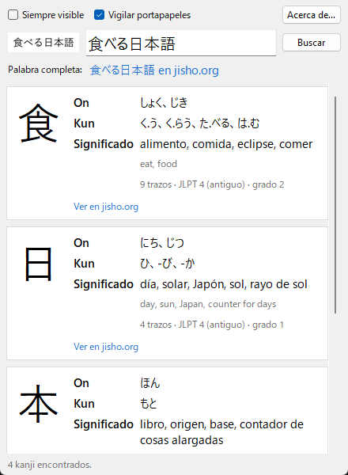

<div align="center">

# Yomitoru 読み取る

**Capturá un kanji de la pantalla y mirá al instante cómo se lee y qué significa.**

App de escritorio para Windows 10/11 · funciona offline · gratis y de código abierto

[**⬇ Descargar Yomitoru.exe**](https://github.com/kukolin/Yomitoru/releases/latest) ·
[Cómo se usa](#cómo-se-usa) ·
[Preguntas frecuentes](#preguntas-frecuentes) ·
[Cómo funciona](#cómo-funciona-por-dentro)



</div>

---

## ¿Qué hace?

*Yomitoru* (読み取る) significa «leer, captar» en japonés. Estás leyendo algo en japonés (un manga, una página web, un juego, un video con subtítulos) y aparece un kanji que no conocés. En vez de dibujarlo en un buscador por trazos:

1. Presionás **Win+Shift+S** y lo seleccionás con el mouse.
2. Yomitoru detecta la captura, reconoce el texto y se abre al frente.

Por cada kanji reconocido te muestra:

| | |
| --- | --- |
| **El kanji** | en grande, para ver bien los trazos |
| **On'yomi** | la lectura de origen chino, en hiragana (にち、じつ) |
| **Kun'yomi** | la lectura japonesa, en hiragana (ひ、-び、-か) |
| **Significado** | en español cuando el diccionario lo tiene (≈2.500 kanji), si no en inglés |
| **Datos extra** | cantidad de trazos, nivel JLPT y grado escolar japonés |
| **jisho.org** | un link a la ficha completa del kanji |

Si capturaste una palabra o una frase, además aparece un link para buscarla completa en jisho.org. Y si el reconocimiento se equivoca, el texto se puede **corregir a mano** y volver a buscar.

**Todo funciona sin internet**: el reconocimiento de texto usa el OCR que ya trae Windows y el diccionario viene incluido. Solo los links a jisho.org necesitan conexión.

## Instalación

### 1. Descargá el programa

Entrá a [**Releases**](https://github.com/kukolin/Yomitoru/releases/latest) y bajá **`Yomitoru.exe`**. No se instala: es un único archivo portable. Guardalo en la carpeta que quieras (por ejemplo `Documentos\Yomitoru`) y abrilo con doble clic.

> **«Windows protegió tu PC»**: como el ejecutable no está firmado digitalmente (los certificados son pagos), Windows SmartScreen puede mostrar este aviso la primera vez. Hacé clic en **Más información → Ejecutar de todas formas**. Si preferís no confiar en un .exe, podés [correrlo desde el código fuente](#desde-el-código-fuente).

### 2. Activá el OCR japonés de Windows (una sola vez)

Yomitoru usa el reconocimiento de texto que trae Windows, pero el de japonés hay que agregarlo. Si no está, la app te avisa al abrirse.

1. Abrí **Configuración → Hora e idioma → Idioma y región**.
2. En «Idiomas preferidos», hacé clic en **Agregar un idioma**.
3. Buscá **Japonés** (日本語) y seleccionalo.
4. Dejá marcada la opción **Reconocimiento óptico de caracteres (OCR)** (las demás son opcionales) e instalá.
5. Reabrí Yomitoru.

No hace falta cambiar el idioma de Windows ni el teclado: tu sistema sigue en español.

### 3. (Opcional) Que se abra al iniciar Windows

Presioná **Win+R**, escribí `shell:startup` y Enter. En la carpeta que se abre, creá un acceso directo a `Yomitoru.exe`.

## Cómo se usa

1. Abrí Yomitoru. Aparece un ícono rojo **読** en la bandeja del sistema (al lado del reloj; puede estar dentro de la flechita ^).
2. Cuando veas un kanji que no conocés, presioná **Win+Shift+S** y encerralo en un rectángulo.
3. La ventana de Yomitoru aparece con el resultado.
4. Presioná **Esc** para esconderla. Vuelve a aparecer sola con la próxima captura.

**Consejos para que reconozca mejor:**

- Encuadrá solo el texto, con un poco de margen. Una palabra o una línea funcionan mejor que un párrafo.
- Texto horizontal. El texto vertical (縦書き, típico de manga) todavía no está soportado: capturá un carácter por vez.
- Si se equivocó, corregí el texto en el campo de arriba y presioná **Enter** o **Buscar**.

**Controles:**

| | |
| --- | --- |
| **Siempre visible** | mantiene la ventana encima de las demás |
| **Vigilar portapapeles** | pausa o reanuda la detección de capturas (también desde el ícono de la bandeja) |
| **Acerca de…** | versión, autor, licencias y links |
| **X** de la ventana | la esconde; Yomitoru sigue en la bandeja |
| Clic derecho en **読** → **Salir** | cierra Yomitoru del todo |

## Preguntas frecuentes

**¿Necesita internet?**
No. Solo para abrir los links a jisho.org.

**¿Guarda mis capturas o las manda a algún lado?**
No. Las imágenes se procesan en memoria, en tu PC, y no se guardan ni se envían a ningún servidor.

**No reconoce 一, 二 o 三.**
Es una limitación del OCR de Windows: los kanji formados solo por rayas horizontales no los detecta como texto. Escribilos a mano en el campo de texto.

**Reconoce mal un carácter.**
Pasa sobre todo con capturas muy chicas o tipografías muy finas. Probá hacer zoom en la página antes de capturar, o corregí el texto a mano. Si te pasa seguido, abrí un [issue](https://github.com/kukolin/Yomitoru/issues) con la captura.

**Saqué una captura y no pasó nada.**
- Fijate que **Vigilar portapapeles** esté activado.
- Si capturás exactamente la misma imagen dos veces seguidas, la segunda se ignora.
- Si Win+Shift+S directamente no abre el recorte, puede que la herramienta Recortes de Windows se haya colgado: abrí el Administrador de tareas (Ctrl+Shift+Esc), finalizá todos los procesos «Recortes» y probá de nuevo. Si se repite, en Configuración → Aplicaciones → Aplicaciones instaladas → Recortes → Opciones avanzadas, usá **Reparar**.

**Dice que ya está abierto.**
Yomitoru solo permite una instancia. Buscá el ícono 読 en la bandeja del sistema.

**¿Por qué el significado aparece en inglés?**
El diccionario KANJIDIC2 tiene traducciones al español para unos 2.500 kanji (entre ellos los más comunes). Para el resto se muestra el inglés.

**¿Qué es «JLPT (antiguo)»?**
KANJIDIC2 indica el nivel del examen JLPT según la escala anterior a 2010, de 4 (básico) a 1 (avanzado). Aproximadamente: 4 ≈ N5, 3 ≈ N4, 2 ≈ N3/N2, 1 ≈ N1.

## Desde el código fuente

Necesitás **Python 3.11 o superior**.

```bat
git clone https://github.com/kukolin/Yomitoru.git
cd Yomitoru
pip install -r requirements.txt
python -m yomitoru.setup_dict
python -m yomitoru
```

`setup_dict` descarga KANJIDIC2 (≈1,5 MB) una sola vez y lo convierte en `data/kanjidic2.sqlite` (si te olvidás, la app ofrece hacerlo al abrirse). Después podés abrirla con doble clic en `Yomitoru.bat`, que la lanza sin consola.

Opciones de línea de comandos:

| Opción | |
| --- | --- |
| `--interval 500` | milisegundos entre revisiones del portapapeles |
| `--no-tray` | sin ícono en la bandeja (cerrar la ventana cierra la app) |
| `--ocr manga` | usar manga-ocr en lugar del OCR de Windows (ver abajo) |

## Cómo funciona por dentro

```
 Win+Shift+S ──► portapapeles ──► ClipboardWatcher ──► OCR ──► diccionario ──► ventana
                                  (cada 500 ms)        (hilo     (SQLite)
                                                       aparte)
```

| Módulo | Qué hace |
| --- | --- |
| [`clipboard.py`](yomitoru/clipboard.py) | Cada 500 ms consulta el contador de cambios del portapapeles de Windows (`GetClipboardSequenceNumber`, prácticamente gratis). Solo cuando cambia lee la imagen con Pillow, y la procesa solo si su hash es distinto del de la anterior. |
| [`ocr/`](yomitoru/ocr/) | Interfaz `OcrEngine.recognize(imagen) -> str`, con dos motores: el de Windows (por defecto) y manga-ocr. |
| [`dictionary.py`](yomitoru/dictionary.py) | Parsea el XML de KANJIDIC2, lo guarda en SQLite y hace las consultas. El on'yomi se guarda ya convertido de katakana a hiragana. |
| [`kana.py`](yomitoru/kana.py) | Conversión katakana → hiragana y detección de kanji (rangos Unicode CJK). |
| [`lookup.py`](yomitoru/lookup.py) | Del texto reconocido a la lista de kanji (sin repetir, ignorando kana y signos) y los links a jisho.org. |
| [`ui.py`](yomitoru/ui.py), [`tray.py`](yomitoru/tray.py), [`app.py`](yomitoru/app.py) | Ventana en Tkinter, ícono de bandeja (pystray) y la orquestación. El OCR corre en un hilo aparte para que la ventana no se congele. |

### El truco del OCR

El OCR de Windows (`Windows.Media.Ocr`, vía [pywinrt](https://github.com/pywinrt/pywinrt)) es rápido y no necesita descargar nada, pero tiene dos debilidades: es muy sensible al tamaño del texto y casi nunca reconoce un kanji suelto. Simplemente agrandar la imagen no alcanza, así que Yomitoru prueba varias versiones de cada captura y vota:

1. **Normaliza**: escala de grises, texto oscuro sobre fondo claro (así funciona también con temas oscuros) y recorte al contenido.
2. **Estima la altura de línea** con el perfil horizontal de tinta y escala para que cada línea quede en 20, 26, 32 y 40 px, en versión normal y engrosada (las tipografías finas fallan más).
3. **Repite el carácter**: si la captura parece un solo carácter, también prueba con `日日日`. El motor reconoce perfectamente una «palabra» de tres kanji iguales aunque no reconozca uno solo.
4. **Descarta resultados imposibles** (por ejemplo, más líneas de las que tiene la imagen: a veces el motor parte 語 en dos renglones) y se queda con el más votado.

Todo junto tarda unos 40 ms por captura.

### Usar manga-ocr

Si necesitás más precisión (sobre todo con manga), hay un segundo motor ya conectado:

```bat
pip install manga-ocr
python -m yomitoru --ocr manga
```

[manga-ocr](https://github.com/kha-white/manga-ocr) es mucho más preciso con japonés y entiende texto vertical, pero instala PyTorch y descarga un modelo de ≈450 MB la primera vez (después funciona offline). No está incluido en el .exe.

Para agregar otro motor, creá una subclase de `OcrEngine` en `yomitoru/ocr/` y registrala en `create_engine`.

## Desarrollo

```bat
pip install -r requirements-dev.txt
python -m pytest
```

Los tests cubren el parseo del diccionario (日 → にち/じつ, ひ/か), la conversión katakana→hiragana, el OCR sobre imágenes generadas con Pillow y el flujo completo con la ventana real. Para probar también con el portapapeles de Windows (lo sobrescribe), definí `YOMITORU_E2E_CLIPBOARD=1` antes de correr pytest.

Para generar el ejecutable:

```bat
build_exe.bat
```

Crea `dist\Yomitoru.exe` (≈20 MB, un solo archivo, con el diccionario incluido) usando PyInstaller.

## Autor

Creado por **Lucas Anezin** ([@kukolin](https://github.com/kukolin)).

¿Encontraste un error o tenés una idea? Abrí un [issue](https://github.com/kukolin/Yomitoru/issues).

## Licencias y créditos

- **Código**: [MIT](LICENSE) © 2026 Lucas Anezin.
- **Diccionario**: este programa usa el archivo [KANJIDIC2](https://www.edrdg.org/wiki/index.php/KANJIDIC_Project), propiedad del **Electronic Dictionary Research and Development Group (EDRDG)**, y se usa de acuerdo con su [licencia](https://www.edrdg.org/edrdg/licence.html): **Creative Commons Attribution-ShareAlike 4.0 (CC BY-SA 4.0)**. La base `kanjidic2.sqlite` incluida en el ejecutable es una obra derivada y se distribuye bajo la misma licencia.
- **OCR**: `Windows.Media.Ocr` de Microsoft, mediante [pywinrt](https://github.com/pywinrt/pywinrt).
- **Links**: [Jisho.org](https://jisho.org), diccionario online de japonés que también usa datos del EDRDG.
- Hecho con [Pillow](https://python-pillow.org), [pystray](https://github.com/moses-palmer/pystray) y Tkinter.
