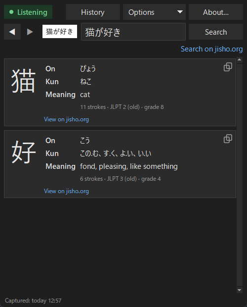

<div align="center">

**English** · [Español](README.es.md) · [日本語](README.ja.md) · [中文](README.zh.md) · [한국어](README.ko.md) · [Português](README.pt.md) · [Français](README.fr.md) · [Deutsch](README.de.md)

# Yomitoru Kanji Reader 読み取る

### Lightweight and fast kanji lookup for Windows

Screenshot any kanji with **Win+Shift+S** and instantly see its readings and meaning.<br>
One small .exe · no installer · works offline · free and open source

[**⬇ Download yomitoru-kanji-reader.exe**](https://github.com/kukolin/yomitoru-kanji-reader/releases/latest) ·
[How to use](#how-to-use) ·
[FAQ](#faq) ·
[How it works](#how-it-works)




</div>

---

## Lightweight and fast

*Yomitoru* (読み取る) means "to read, to take in" in Japanese. Yomitoru Kanji Reader is built to stay out of your way while you read Japanese: a manga, a website, a game or subtitles. When an unknown kanji shows up, you don't draw it in a stroke search. You screenshot it, and the answer is there before you look back.

| | |
| --- | --- |
| **Fast** | About **0.1 s** from screenshot to result. Recognition itself takes ~30 ms. |
| **Light** | A single **20 MB** .exe. No installer, no runtime to install, ~60–80 MB of RAM while running. |
| **Offline** | Uses the OCR built into Windows and a bundled dictionary. Nothing is sent anywhere; only the jisho.org links need internet. |
| **Quiet** | Waits in the system tray. It only checks a clipboard counter twice a second, so it uses practically no CPU. |

*Measured on a regular Windows 11 laptop.*

## What it shows

For every kanji in your screenshot:

| | |
| --- | --- |
| **The kanji** | large, so the strokes are easy to see |
| **On'yomi** | the Chinese-derived reading, in hiragana (にち、じつ) |
| **Kun'yomi** | the native Japanese reading, in hiragana (ひ、-び、-か) |
| **Meaning** | in the app's language when the dictionary has it (English, Spanish, French or Portuguese), otherwise in English |
| **Extra info** | stroke count, JLPT level and Japanese school grade |
| **jisho.org** | a link to the kanji's full entry |

**Search on jisho.org** looks up whatever is typed in the text field: the whole word or sentence. If recognition gets something wrong, **fix the text** and search again.

Every lookup is kept in the **history**, so ◀ ▶ take you back to a kanji from a while ago. There is a **dark mode**, and the app speaks **10 languages**: English, español, 日本語, 中文, 한국어, français, português, Deutsch, italiano and русский.

## Installation

### 1. Download

Go to [**Releases**](https://github.com/kukolin/yomitoru-kanji-reader/releases/latest) and download **`yomitoru-kanji-reader.exe`**. Nothing to install: put it in any folder (for example `Documents\Yomitoru Kanji Reader`) and double-click it.

> **"Windows protected your PC"**: the .exe is not digitally signed (certificates are expensive), so Windows SmartScreen may show this warning the first time. Click **More info → Run anyway**. If you'd rather not trust an .exe, [run it from source](#from-source).

### 2. Turn on Windows' Japanese OCR (once)

Yomitoru Kanji Reader uses the text recognition built into Windows, but Japanese has to be added. If it's missing, the app tells you when it starts.

1. Open **Settings → Time & language → Language & region**.
2. Under "Preferred languages", click **Add a language**.
3. Search for **Japanese** (日本語) and select it.
4. Keep **Optical character recognition (OCR)** checked (the other options are optional) and install.
5. Reopen Yomitoru Kanji Reader.

You don't need to change your Windows display language or keyboard.

### 3. (Optional) Start with Windows

Press **Win+R**, type `shell:startup` and press Enter. In the folder that opens, create a shortcut to `yomitoru-kanji-reader.exe`.

## How to use

1. Open Yomitoru Kanji Reader. **● Listening** at the top left means it's watching for your screenshots. A red **読** icon also appears in the system tray (next to the clock, maybe under the ^ arrow).
2. When you see a kanji you don't know, press **Win+Shift+S** and draw a rectangle around it.
3. The Yomitoru Kanji Reader window pops up with the result.
4. Press **Esc** to hide it. It comes back with the next screenshot.

**Tips for better recognition**

- Frame just the text, with a little margin. A word or a line works better than a paragraph.
- Horizontal text. Vertical text (縦書き, common in manga) isn't supported yet: capture one character at a time.
- If something is wrong, fix it in the text field and press **Enter** or **Search**.

**Controls**

| | |
| --- | --- |
| **● Listening / ○ Off** | click to pause or resume screenshot detection (also from the tray icon). When off, the app ignores whatever you copy |
| **◀ ▶** (or **Alt+←** / **Alt+→**) | previous or next lookup in the history |
| **History** (or **Ctrl+H**) | every lookup with its date; double-click to reopen one, and a button to clear it |
| **Search on jisho.org** | searches jisho.org for whatever is typed in the text field |
| **Copy** | select any reading or meaning and press **Ctrl+C** (or right-click → **Copy**); the icon under each kanji copies the kanji straight away |
| **Options** | settings you can switch on and off, and the language (see below) |
| **About…** | version, author, licenses and links (also from the tray icon) |
| **Esc** or the window's **X** | hides the window; the app keeps running in the tray |
| Right-click **読** → **Quit** | closes Yomitoru Kanji Reader completely |

**Options** (remembered for next time)

| Option | What it does | Default |
| --- | --- | --- |
| Show the window on capture | brings the window to the front with every screenshot | on |
| Always on top | keeps the window above other windows | off |
| Dark mode | dark colors, including the title bar | same as Windows |
| Language | language of the app and of the meanings | same as Windows |

The status bar shows when the current lookup happened: **Captured: today 19:42** for a screenshot, or **Searched: today 19:42** if you typed it.

Settings and history (text only, never images) are stored in `%APPDATA%\Yomitoru`. Delete that folder to start fresh.

## FAQ

**Does it need internet?**
No. Only to open the jisho.org links.

**Does it store my screenshots or send them anywhere?**
No. Images are processed in memory on your PC and are never saved or uploaded. The history keeps only the recognized text and the date, on your PC (`%APPDATA%\Yomitoru\history.json`), and you can clear it any time from **History → Clear history…**.

**It doesn't recognize 一, 二 or 三.**
That's a limitation of the Windows OCR: kanji made only of horizontal strokes aren't detected as text. Type them in the text field.

**It misreads a character.**
Mostly with very small screenshots or very thin fonts. Zoom in before capturing, or fix the text by hand. If it happens a lot, open an [issue](https://github.com/kukolin/yomitoru-kanji-reader/issues) with the screenshot.

**I took a screenshot and nothing happened.**
- Check that the top left says **● Listening** and not **○ Off** (one click switches it).
- Capturing the exact same image twice in a row: the second one is ignored.
- If Win+Shift+S doesn't open the snipping overlay at all, Windows' Snipping Tool may be stuck: open Task Manager (Ctrl+Shift+Esc), end every "Snipping Tool" process and try again. If it keeps happening, use **Repair** in Settings → Apps → Installed apps → Snipping Tool → Advanced options.

**It says it's already running.**
Only one instance is allowed. Look for the 読 icon in the system tray.

**Why is the meaning in English?**
KANJIDIC2 has English meanings for about 10,400 kanji, plus Spanish (~2,500), French (~2,100) and Portuguese (~1,900), including the most common ones. When a kanji has no translation to your language, or the app is set to a language KANJIDIC2 doesn't include (Japanese, Chinese, Korean, German, Italian or Russian), the English meaning is shown with a short note.

**What is "JLPT (old)"?**
KANJIDIC2 uses the pre-2010 JLPT scale, from 4 (beginner) to 1 (advanced). Roughly: 4 ≈ N5, 3 ≈ N4, 2 ≈ N3/N2, 1 ≈ N1.

## From source

You need **Python 3.11 or newer**.

```bat
git clone https://github.com/kukolin/yomitoru-kanji-reader.git
cd yomitoru-kanji-reader
pip install -r requirements.txt
python -m yomitoru.setup_dict
python -m yomitoru
```

`setup_dict` downloads KANJIDIC2 (~1.5 MB) once and converts it into `data/kanjidic2.sqlite` (if you forget, the app offers to do it on startup). Afterwards you can double-click `yomitoru-kanji-reader.bat`, which starts it without a console.

Command-line options:

| Option | |
| --- | --- |
| `--interval 500` | milliseconds between clipboard checks |
| `--no-tray` | no tray icon (closing the window quits the app) |
| `--ocr manga` | use manga-ocr instead of the Windows OCR (see below) |

## How it works

```
 Win+Shift+S ──► clipboard ──► ClipboardWatcher ──► OCR ──► dictionary ──► window
                               (every 500 ms)       (worker   (SQLite)
                                                     thread)
```

| Module | What it does |
| --- | --- |
| [`clipboard.py`](yomitoru/clipboard.py) | Every 500 ms it reads the Windows clipboard change counter (`GetClipboardSequenceNumber`, practically free). Only when it changes does it read the image with Pillow, and it processes it only if its hash is new. |
| [`ocr/`](yomitoru/ocr/) | `OcrEngine.recognize(image) -> str` interface with two engines: Windows (default) and manga-ocr. |
| [`dictionary.py`](yomitoru/dictionary.py) | Parses the KANJIDIC2 XML, stores it in SQLite and runs the lookups. On'yomi is stored already converted from katakana to hiragana; meanings in English, Spanish, French and Portuguese. |
| [`kana.py`](yomitoru/kana.py) | Katakana → hiragana conversion and kanji detection (CJK Unicode ranges). |
| [`lookup.py`](yomitoru/lookup.py) | From recognized text to the list of kanji (no repeats, ignoring kana and symbols) and the jisho.org links. |
| [`history.py`](yomitoru/history.py) | Chronological history (up to 500 lookups) with a cursor for ◀ ▶, saved as JSON. |
| [`settings.py`](yomitoru/settings.py) | Options menu settings, saved as JSON. |
| [`i18n.py`](yomitoru/i18n.py) | UI texts in 10 languages, plus localized dates ("today 19:42"). To add a language, add its dictionary of texts; a test flags anything missing. |
| [`theme.py`](yomitoru/theme.py) | Light and dark palettes applied to ttk, menus and the Windows title bar. |
| [`ui.py`](yomitoru/ui.py), [`tray.py`](yomitoru/tray.py), [`app.py`](yomitoru/app.py) | Tkinter windows (main, history, About), tray icon (pystray) and orchestration. OCR runs on a worker thread so the window never freezes. |

### The OCR trick

The Windows OCR (`Windows.Media.Ocr`, through [pywinrt](https://github.com/pywinrt/pywinrt)) is fast and needs no download, but it has two weaknesses: it's very sensitive to text size, and it almost never recognizes a single kanji. Simply scaling the image up isn't enough, so Yomitoru Kanji Reader tries several versions of every screenshot and votes:

1. **Normalize**: grayscale, dark text on a light background (so dark themes work too), cropped to the content.
2. **Estimate the line height** from the horizontal ink profile and scale so each line is 20, 26, 32 and 40 px tall, both normal and bolder (thin fonts fail more often).
3. **Repeat the character**: if the screenshot looks like a single character, also try `日日日`. The engine reads a three-kanji "word" just fine even when it can't read one kanji alone.
4. **Drop impossible results** (for example, more lines than the image has: the engine sometimes splits 語 into two rows) and keep the most voted one.

All of that takes about 30 ms per screenshot.

### Using manga-ocr

If you need more accuracy (especially with manga), a second engine is already wired in:

```bat
pip install manga-ocr
python -m yomitoru --ocr manga
```

[manga-ocr](https://github.com/kha-white/manga-ocr) is much more accurate with Japanese and handles vertical text, but it installs PyTorch and downloads a ~450 MB model the first time (it works offline afterwards). It isn't included in the .exe, which is what keeps the .exe lightweight.

To add another engine, subclass `OcrEngine` in `yomitoru/ocr/` and register it in `create_engine`.

## Development

```bat
pip install -r requirements-dev.txt
python -m pytest
```

The tests cover dictionary parsing (日 → にち/じつ, ひ/か), katakana→hiragana conversion, OCR on images rendered with Pillow, history and settings, that no translation is missing, and the full flow with the real window (arrows, history, dark mode and live language switching). To also test with the real Windows clipboard (it gets overwritten), set `YOMITORU_E2E_CLIPBOARD=1` before running pytest.

To build the executable:

```bat
build_exe.bat
```

It creates `dist\yomitoru-kanji-reader.exe` (~20 MB, a single file with the dictionary inside) with PyInstaller.

## Author

Created by **Lucas Anezin** ([@kukolin](https://github.com/kukolin)).

Found a bug or have an idea? Open an [issue](https://github.com/kukolin/yomitoru-kanji-reader/issues).

## License and credits

- **Code**: [MIT](LICENSE) © 2026 Lucas Anezin.
- **Dictionary**: this program uses the [KANJIDIC2](https://www.edrdg.org/wiki/index.php/KANJIDIC_Project) file, which is the property of the **Electronic Dictionary Research and Development Group (EDRDG)**, and is used in conformance with the Group's [licence](https://www.edrdg.org/edrdg/licence.html): **Creative Commons Attribution-ShareAlike 4.0 (CC BY-SA 4.0)**. The `kanjidic2.sqlite` database bundled in the executable is a derivative work distributed under the same licence.
- **OCR**: Microsoft's `Windows.Media.Ocr`, through [pywinrt](https://github.com/pywinrt/pywinrt).
- **Links**: [Jisho.org](https://jisho.org), an online Japanese dictionary that also uses EDRDG data.
- Built with [Pillow](https://python-pillow.org), [pystray](https://github.com/moses-palmer/pystray) and Tkinter.
