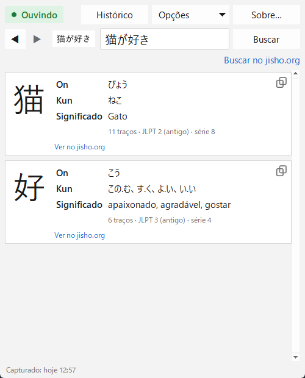

[English](README.md) · [Español](README.es.md) · [日本語](README.ja.md) · [中文](README.zh.md) · [한국어](README.ko.md) · **Português** · [Français](README.fr.md) · [Deutsch](README.de.md)

# Yomitoru Kanji Reader 読み取る

### Consulta de kanji leve e rápida para Windows

Capture qualquer kanji com **Win+Shift+S** e veja na hora suas leituras e seu significado. 
Um único .exe pequeno · sem instalador · funciona offline · grátis e de código aberto

[**⬇ Baixar yomitoru-kanji-reader.exe**](https://github.com/kukolin/yomitoru-kanji-reader/releases/latest) ·
[Como usar](#como-usar) ·
[Perguntas frequentes](#perguntas-frequentes)

---

## Leve e rápido

*Yomitoru* (読み取る) significa "ler, captar" em japonês. O Yomitoru Kanji Reader foi feito para não atrapalhar enquanto você lê japonês: um mangá, um site, um jogo ou legendas. Quando aparece um kanji desconhecido, não precisa desenhá-lo numa busca por traços: basta capturá-lo e a resposta já está lá.

| | |
| --- | --- |
| **Rápido** | Cerca de **0,1 s** da captura ao resultado. O reconhecimento em si leva ~30 ms. |
| **Leve** | Um único .exe de **20 MB**. Sem instalador nem nada extra para instalar; usa ~60–80 MB de RAM. |
| **Offline** | Usa o OCR que já vem no Windows e um dicionário incluído. Nada é enviado; só os links do jisho.org precisam de internet. |
| **Silencioso** | Fica esperando na bandeja do sistema. Só verifica um contador da área de transferência duas vezes por segundo, então quase não usa CPU. |

## O que mostra

Para cada kanji da captura:

| | |
| --- | --- |
| **O kanji** | grande, para ver bem os traços |
| **On'yomi** | a leitura de origem chinesa, em hiragana (にち、じつ) |
| **Kun'yomi** | a leitura japonesa, em hiragana (ひ、-び、-か) |
| **Significado** | no idioma do app quando o dicionário tem (português, inglês, espanhol ou francês); senão, em inglês |
| **Extras** | número de traços, nível JLPT e série escolar japonesa |
| **jisho.org** | um link para a página completa do kanji |

**Buscar no jisho.org** pesquisa o que estiver escrito no campo de texto: a palavra ou frase inteira. Se o reconhecimento errar, **corrija o texto** e busque de novo.

Cada busca fica no **histórico**, então com ◀ ▶ você volta a um kanji de pouco antes. Tem **modo escuro** e está em **10 idiomas**: português, English, español, 日本語, 中文, 한국어, français, Deutsch, italiano e русский.

## Instalação

### 1. Baixe

Acesse [**Releases**](https://github.com/kukolin/yomitoru-kanji-reader/releases/latest) e baixe **`yomitoru-kanji-reader.exe`**. Não precisa instalar: coloque em qualquer pasta e abra com dois cliques.

> **"O Windows protegeu o computador"**: o .exe não tem assinatura digital, então o SmartScreen pode mostrar esse aviso na primeira vez. Clique em **Mais informações → Executar assim mesmo**.

### 2. Ative o OCR japonês do Windows (uma vez só)

1. Abra **Configurações → Hora e idioma → Idioma e região**.
2. Em "Idiomas preferenciais", clique em **Adicionar um idioma**.
3. Procure **Japonês** (日本語) e selecione.
4. Deixe marcado **Reconhecimento óptico de caracteres (OCR)** (o resto é opcional) e instale.
5. Abra o Yomitoru Kanji Reader de novo.

Não é preciso mudar o idioma do Windows nem o teclado. Se faltar o OCR japonês, o app avisa ao abrir.

### 3. (Opcional) Abrir com o Windows

Pressione **Win+R**, digite `shell:startup` e Enter. Na pasta que abrir, crie um atalho para `yomitoru-kanji-reader.exe`.

## Como usar

1. Abra o Yomitoru Kanji Reader. **● Ouvindo**, no canto superior esquerdo, indica que ele está esperando suas capturas. Também aparece um ícone vermelho **読** na bandeja do sistema.
2. Quando vir um kanji desconhecido, pressione **Win+Shift+S** e desenhe um retângulo em volta dele.
3. A janela aparece com o resultado.
4. **Esc** esconde a janela. Ela volta na próxima captura.

**Dicas:** enquadre só o texto, com uma pequena margem (uma palavra ou uma linha funciona melhor que um parágrafo). Texto vertical (縦書き) ainda não é suportado: capture um caractere por vez.

| Controle | |
| --- | --- |
| **● Ouvindo / ○ Desligado** | um clique pausa ou retoma a detecção de capturas (também pelo ícone da bandeja) |
| **◀ ▶** (ou **Alt+←** / **Alt+→**) | busca anterior ou seguinte do histórico |
| **Histórico** (ou **Ctrl+H**) | todas as buscas com a data; dois cliques para reabrir uma, e um botão para apagar |
| **Buscar no jisho.org** | pesquisa no jisho.org o que estiver no campo de texto |
| **Copiar** | selecione qualquer leitura ou significado e pressione **Ctrl+C** (ou clique direito → **Copiar**); o ícone abaixo de cada kanji copia o kanji direto |
| **Opções** | mostrar a janela ao capturar, abrir o jisho.org direto ao capturar (se houver texto japonês, busca no jisho.org sem mostrar a janela), sempre visível, modo escuro e idioma (padrão: inglês; mude em **Opções → Idioma / Language**) |
| **Esc** ou o **X** da janela | esconde a janela; o app continua na bandeja |
| Clique direito em **読** → **Sair** | fecha o Yomitoru Kanji Reader completamente |

## Perguntas frequentes

**Ele guarda ou envia minhas capturas?**
Não. As imagens são processadas na memória do seu PC e nunca são salvas nem enviadas. O histórico guarda só o texto reconhecido e a data, e pode ser apagado em **Histórico → Apagar histórico…**.

**Não reconhece 一, 二 ou 三.**
É uma limitação do OCR do Windows: kanji feitos só de traços horizontais não são detectados como texto. Digite-os no campo de texto.

**Por que o significado aparece em inglês?**
O KANJIDIC2 tem significados em inglês para ~10.400 kanji e em português para ~1.900 (os mais comuns). Sem tradução, aparece em inglês com um aviso.

**O que é "JLPT (antigo)"?**
A escala do JLPT anterior a 2010, de 4 (básico) a 1 (avançado). Aproximadamente: 4 ≈ N5, 3 ≈ N4, 2 ≈ N3/N2, 1 ≈ N1.

## Para desenvolvedores

Como rodar pelo código-fonte, como funciona por dentro e como gerar o .exe: veja o [README em inglês](README.md#from-source).

## Autor

Criado por **Lucas Anezin** ([@kukolin](https://github.com/kukolin)). Encontrou um erro ou tem uma ideia? Abra uma [issue](https://github.com/kukolin/yomitoru-kanji-reader/issues).

## Licenças

Código: [MIT](LICENSE) © 2026 Lucas Anezin. Este programa usa o arquivo [KANJIDIC2](https://www.edrdg.org/wiki/index.php/KANJIDIC_Project), propriedade do **Electronic Dictionary Research and Development Group (EDRDG)**, de acordo com a [licença](https://www.edrdg.org/edrdg/licence.html) **CC BY-SA 4.0**. OCR: `Windows.Media.Ocr` da Microsoft.
