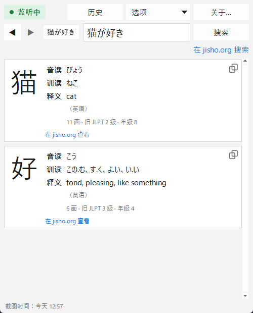

[English](README.md) · [Español](README.es.md) · [日本語](README.ja.md) · **中文** · [한국어](README.ko.md) · [Português](README.pt.md) · [Français](README.fr.md) · [Deutsch](README.de.md)

# Yomitoru Kanji Reader 読み取る

### 轻量、快速的 Windows 日语汉字查询工具

用 **Win+Shift+S** 截取任意日语汉字，立即查看它的读音和释义。 
一个小巧的 .exe · 无需安装 · 离线可用 · 免费开源

[**⬇ 下载 yomitoru-kanji-reader.exe**](https://github.com/kukolin/yomitoru-kanji-reader/releases/latest) ·
[使用方法](#使用方法) ·
[常见问题](#常见问题)

---

## 轻量又快速

Yomitoru（読み取る）在日语中意为“读取”。Yomitoru Kanji Reader 的设计目标是在你阅读日语（漫画、网页、游戏或字幕）时不打扰你。遇到不认识的汉字时，不必在手写输入里一笔一画地描，只要截图，答案马上出现。

| | |
| --- | --- |
| **快** | 从截图到显示结果约 **0.1 秒**，文字识别本身约 30 毫秒。 |
| **轻** | 只有一个 **20 MB** 的 .exe。无需安装程序或额外运行库，运行时约占 60–80 MB 内存。 |
| **离线** | 使用 Windows 自带的 OCR 和内置词典，不会向任何地方发送数据（只有打开 jisho.org 链接时需要联网）。 |
| **安静** | 在系统托盘中待命，每秒只检查两次剪贴板计数器，几乎不占用 CPU。 |

## 显示内容

截图中的每个汉字都会显示：

| | |
| --- | --- |
| **汉字** | 大字显示，笔画清晰 |
| **音读** | 用平假名显示（にち、じつ） |
| **训读** | 用平假名显示（ひ、-び、-か） |
| **释义** | 词典中有对应语言时用应用的语言（英语、西班牙语、法语、葡萄牙语），否则用英语 |
| **其他** | 笔画数、JLPT 等级和日本学校年级 |
| **jisho.org** | 指向该汉字详细页面的链接 |

**在 jisho.org 搜索** 会搜索文本框中当前输入的内容（整个词或句子）。如果识别有误，可以**直接修改文字**再搜索。

每次查询都会保存在**历史记录**中，用 ◀ ▶ 可以回到之前查过的汉字。支持**深色模式**，界面提供 **10 种语言**：English、español、日本語、中文、한국어、français、português、Deutsch、italiano 和 русский。

## 安装

### 1. 下载

前往 [**Releases**](https://github.com/kukolin/yomitoru-kanji-reader/releases/latest) 下载 **`yomitoru-kanji-reader.exe`**。无需安装，放在任意文件夹中双击即可运行。

> **“Windows 已保护你的电脑”**：这个 .exe 没有数字签名，第一次运行时 SmartScreen 可能会提示。点击 **“更多信息” → “仍要运行”** 即可。

### 2. 启用 Windows 日语 OCR（只需一次）

1. 打开 **设置 → 时间和语言 → 语言和区域**。
2. 在“首选语言”中点击 **添加语言**。
3. 搜索 **日语**（日本語）并选择。
4. 勾选 **光学字符识别(OCR)**（其他功能可选），然后安装。
5. 重新打开 Yomitoru Kanji Reader。

无需更改 Windows 的显示语言或键盘。如果缺少日语 OCR，应用启动时会提示你。

### 3.（可选）开机自动启动

按 **Win+R**，输入 `shell:startup` 并回车，在打开的文件夹中创建 `yomitoru-kanji-reader.exe` 的快捷方式。

## 使用方法

1. 打开 Yomitoru Kanji Reader。左上角的 **● 监听中** 表示正在等待你的截图，系统托盘中也会出现红色的 **読** 图标。
2. 看到不认识的汉字时，按 **Win+Shift+S** 框选它。
3. 窗口会弹到最前面并显示结果。
4. 按 **Esc** 隐藏窗口，下次截图时会再次出现。

**小技巧：** 只框选文字并留一点边距（一个词或一行比一整段更准确）。暂不支持竖排文字（縦書き），请逐字截取。

| 操作 | |
| --- | --- |
| **● 监听中 / ○ 已关闭** | 点击即可暂停或恢复截图检测（也可从托盘图标操作） |
| **◀ ▶**（或 **Alt+←** / **Alt+→**） | 历史记录中的上一个或下一个查询 |
| **历史**（或 **Ctrl+H**） | 所有查询及时间；双击重新打开，也可以一键清除 |
| **在 jisho.org 搜索** | 在 jisho.org 搜索文本框中的内容 |
| **复制** | 选中任意读音或释义后按 **Ctrl+C**（或右键 → **复制**）；每个汉字下方的图标可直接复制该汉字 |
| **选项** | 截图时显示窗口、窗口置顶、深色模式和语言 |
| **Esc** 或窗口的 **×** | 隐藏窗口，应用继续在托盘中运行 |
| 右键 **読** → **退出** | 完全退出 Yomitoru Kanji Reader |

## 常见问题

**会保存或上传我的截图吗？**
不会。图片只在你电脑的内存中处理，不会保存或上传。历史记录只保存识别出的文字和时间，可以随时在 **历史 → 清除历史…** 中删除。

**无法识别 一、二、三。**
这是 Windows OCR 的限制：只由横线构成的汉字不会被识别为文字。请在文本框中手动输入。

**为什么释义是英文？**
KANJIDIC2 没有中文释义，所以使用中文界面时显示英文释义，并附有说明。

**“旧 JLPT”是什么？**
2010 年以前的 JLPT 等级，从 4 级（入门）到 1 级（高级）。大致对应：4 级 ≈ N5，3 级 ≈ N4，2 级 ≈ N3/N2，1 级 ≈ N1。

## 开发者

从源代码运行、工作原理以及构建 .exe 的方法，请参阅[英文 README](README.md#from-source)。

## 作者

**Lucas Anezin**（[@kukolin](https://github.com/kukolin)）。发现问题或有建议？欢迎提交 [issue](https://github.com/kukolin/yomitoru-kanji-reader/issues)。

## 许可

代码：[MIT](LICENSE) © 2026 Lucas Anezin。本程序使用 **Electronic Dictionary Research and Development Group (EDRDG)** 所有的 [KANJIDIC2](https://www.edrdg.org/wiki/index.php/KANJIDIC_Project) 文件，并依照该组织的[许可协议](https://www.edrdg.org/edrdg/licence.html)（**CC BY-SA 4.0**）使用。OCR：Microsoft 的 `Windows.Media.Ocr`。
